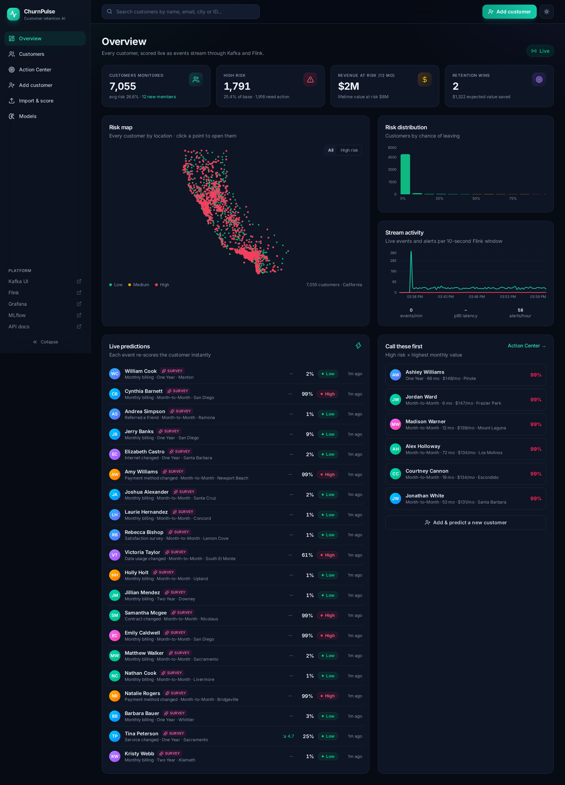
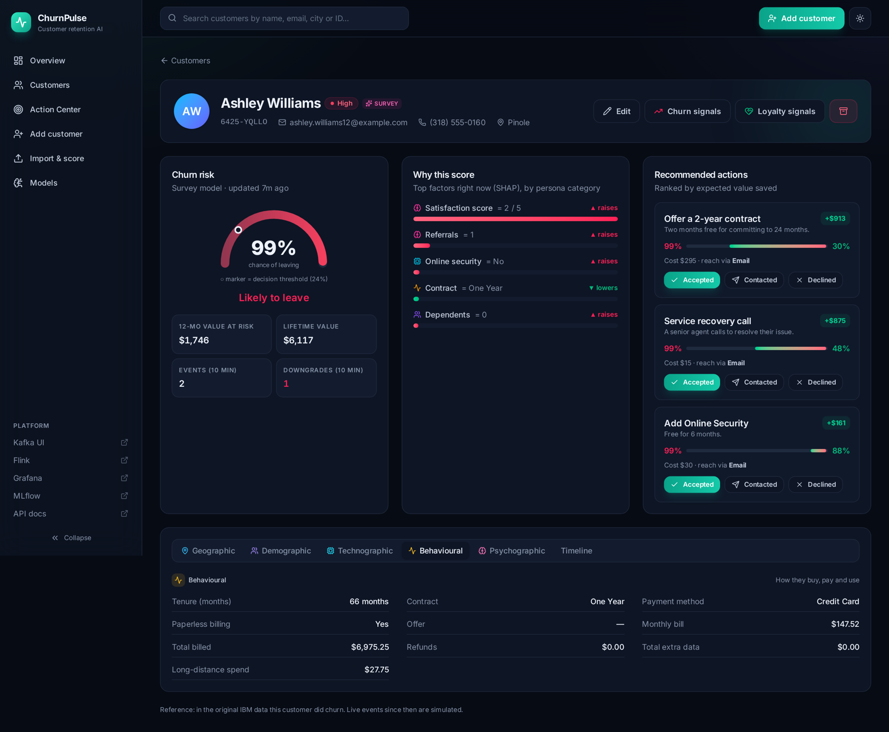
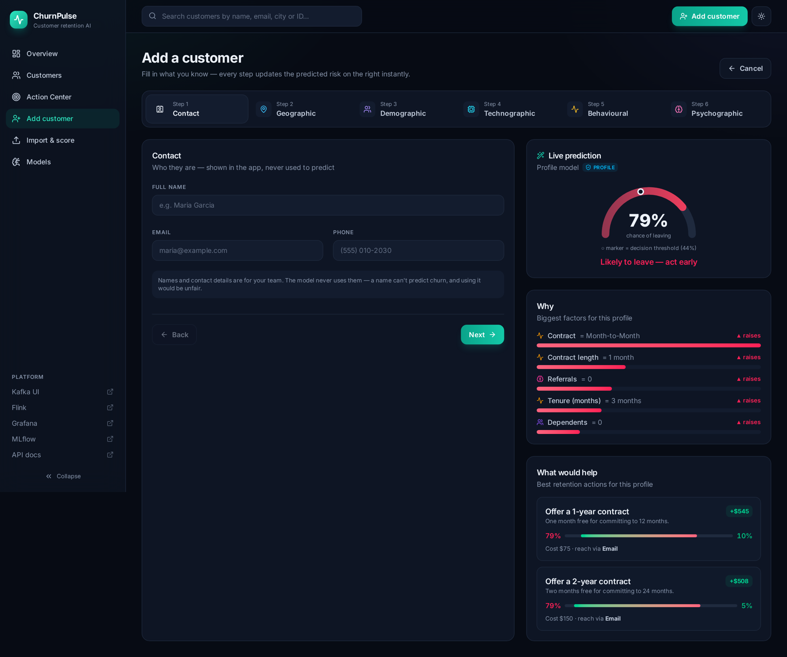
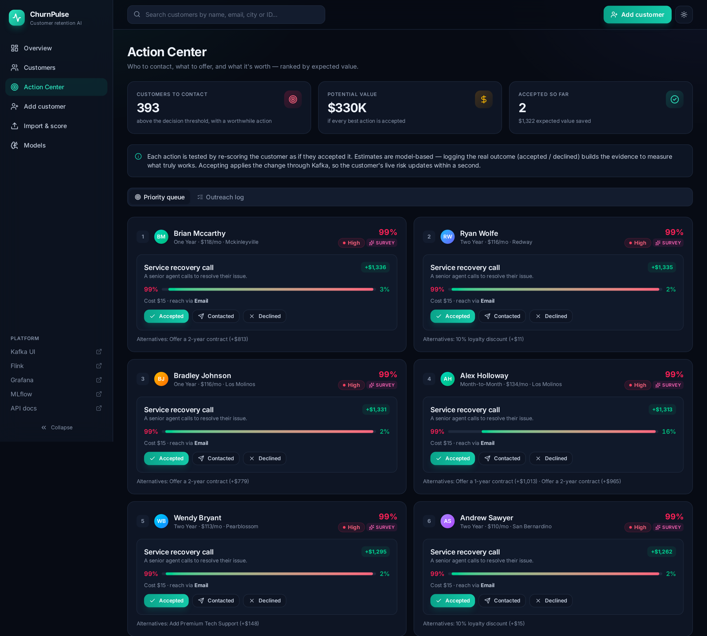
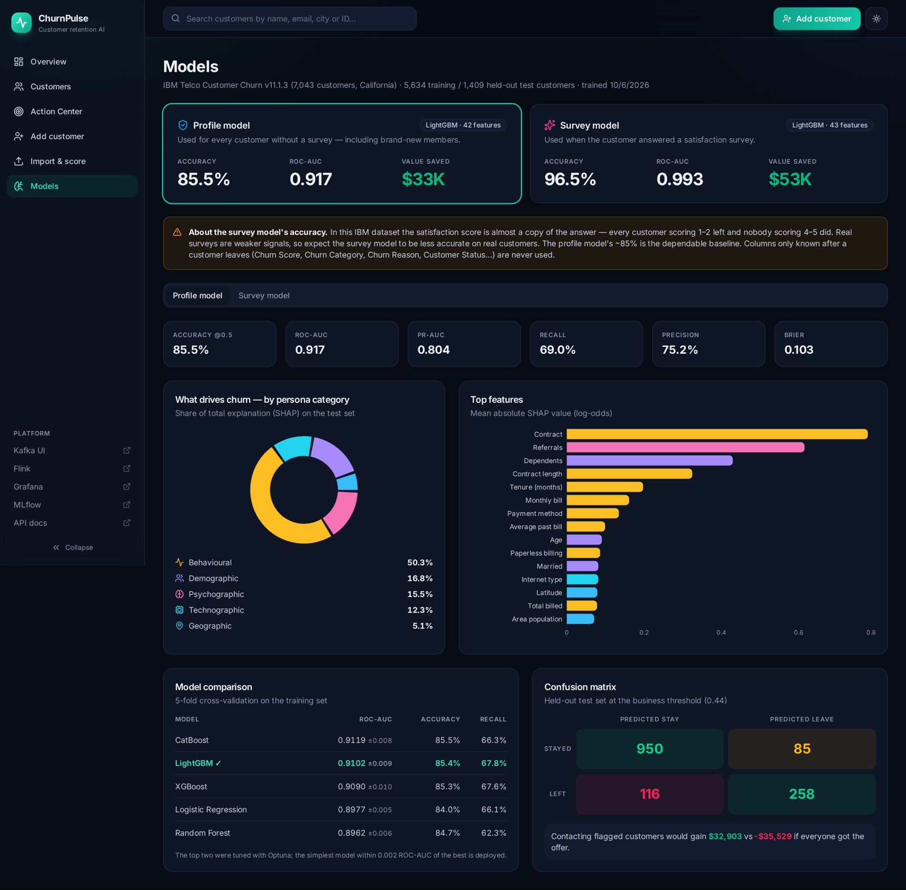
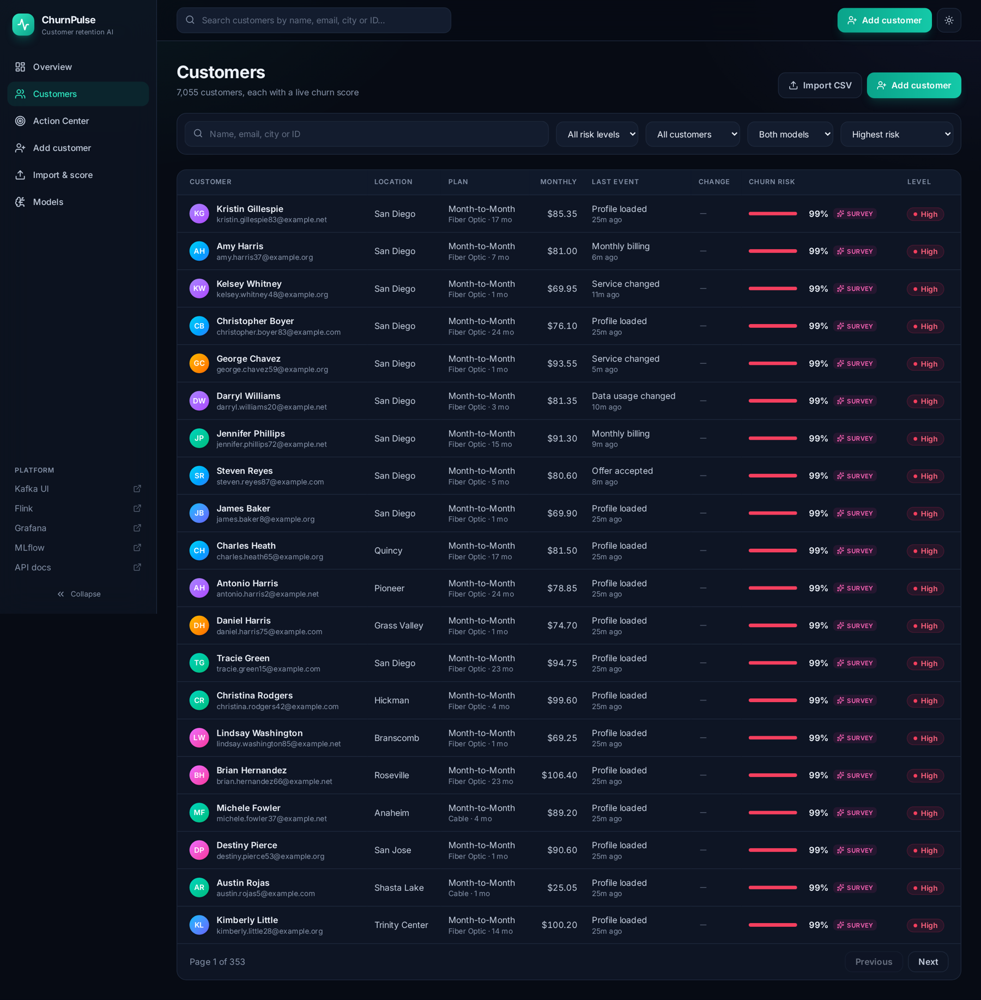
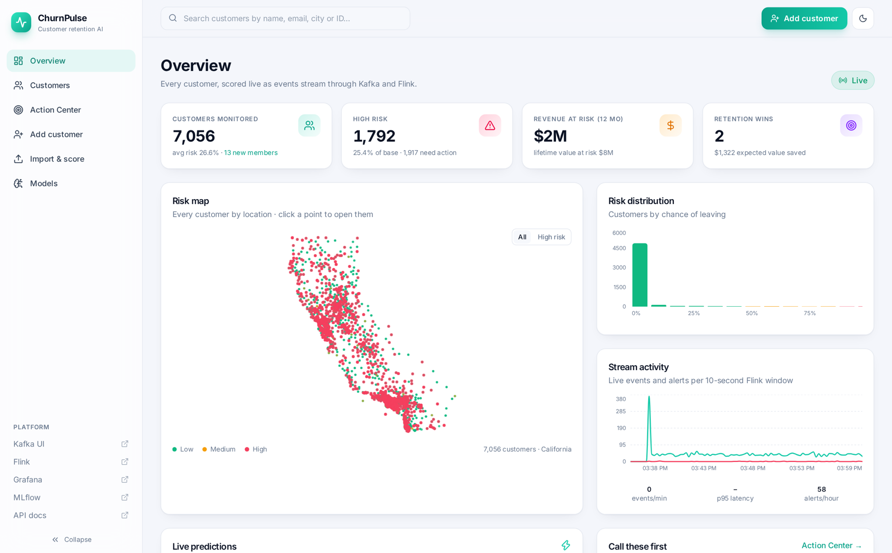
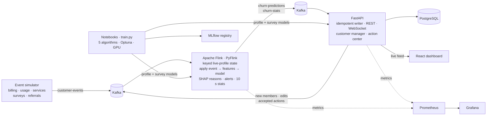

<div align="center">


# ChurnPulse — Real-Time Customer Churn Prediction

**Predict which customers are about to leave, explain why, and recommend the action that keeps them — live.**

An end-to-end, production-style machine learning platform: persona-based churn models, a Kafka + Apache Flink
streaming pipeline, explainable predictions, a retention action center and a modern React dashboard.

[](https://github.com/Muktaditbf/churnpulse-customer-churn-prediction/actions/workflows/ci.yml)




</div>

---

## Contents

- [Why ChurnPulse](#why-churnpulse)
- [Highlights](#highlights)
- [Results](#results)
- [Screenshots](#screenshots)
- [Quick start](#quick-start)
- [Using the API](#using-the-api)
- [How it works](#how-it-works)
- [Machine learning approach](#machine-learning-approach)
- [Project structure](#project-structure)
- [Configuration](#configuration)
- [Testing & quality](#testing--quality)
- [Limitations](#limitations)
- [Roadmap](#roadmap)
- [Author](#author)

## Why ChurnPulse

Keeping a customer is far cheaper than winning a new one, yet most churn models stop at a spreadsheet of
probabilities. ChurnPulse shows what a **complete churn system** looks like:

- it **scores customers continuously** as their behaviour changes, not once a month;
- it **explains every score** in plain categories a retention team understands;
- it turns predictions into **decisions** — which customer to call, what to offer, and what that is worth;
- it is built with the **tools used in industry** (Kafka, Flink, FastAPI, MLflow, Prometheus, Grafana) and the
  practices that make them reliable (event sourcing, idempotent writes, shared feature code, tests, CI).

Use it as a learning reference for real-time ML, a portfolio project template, or a starting point for a churn
solution on your own data.

## Highlights

| | |
|---|---|
| 🎯 **Two routed models** | **85.5% accuracy** from a customer's profile alone; **96.5%** when a satisfaction survey is known — chosen automatically per customer |
| 🧩 **Five persona lenses** | Geographic · demographic · technographic · behavioural · psychographic — data entry, explanations and importance are all grouped by them |
| ⚡ **Real-time scoring** | Event → Kafka → Flink → model → API → PostgreSQL → browser in **~150 ms** (p95 < 250 ms) |
| 🔍 **Explainable** | Exact SHAP reasons for every live prediction, coloured by persona category |
| 💡 **Retention action center** | Ranked next-best actions with cost and expected value; accepting one updates the customer's live risk |
| 👤 **Customer manager** | Add members through a 6-step form with **live risk preview**, edit, archive, or **import thousands from CSV** |
| 🗺️ **Risk map** | Every customer plotted by location and risk — click a point to open their profile |
| 🌗 **Modern UI** | React + Tailwind, dark & light themes, animations, responsive layout |
| 📊 **Observability** | Prometheus metrics and a provisioned Grafana dashboard; MLflow experiment tracking and model registry |
| ✅ **Tested** | 39 tests (33 unit + 6 end-to-end against the live stack) and GitHub Actions CI |

## Results

Evaluated once on a **held-out test set of 1,409 customers** never used for training, tuning or threshold choice.

| Model | When it's used | Accuracy | ROC-AUC | PR-AUC | Recall @ threshold |
|---|---|---|---|---|---|
| **Profile model** (LightGBM, 42 features) | every customer without a survey, incl. new members | **85.5%** | **0.917** | 0.804 | 69.0% |
| **Survey model** (LightGBM, 43 features) | customers who answered a satisfaction survey | **96.5%** | **0.993** | 0.984 | 93.0% |

Five algorithms were compared with 5-fold cross-validation (Logistic Regression, Random Forest, XGBoost on GPU,
LightGBM, CatBoost); the top two were tuned with Optuna and the simplest model within 0.002 ROC-AUC of the best was
deployed. Targeting customers above the business-optimised threshold saves an estimated **$32,903** on the test set,
versus a **$35,529 loss** if every customer received the retention offer.

> **Honest note on the 96.5%.** In this dataset the satisfaction score almost mirrors the label — every customer
> scoring 1–2 left and nobody scoring 4–5 did. Real surveys are weaker signals, so treat the **profile model's 85.5%**
> as the dependable baseline. Columns only known *after* a customer leaves (Churn Score, Churn Category, Churn Reason,
> Customer Status, CLTV) are never model inputs — a test enforces this.

## Screenshots

<table>
<tr>
<td width="50%"></td>
<td width="50%"></td>
</tr>
<tr>
<td align="center"><b>Customer 360</b> — live risk, SHAP reasons, ranked actions, persona tabs, timeline</td>
<td align="center"><b>Add customer</b> — six persona steps with a live prediction as you type</td>
</tr>
<tr>
<td></td>
<td></td>
</tr>
<tr>
<td align="center"><b>Action Center</b> — who to contact, what to offer, what it's worth</td>
<td align="center"><b>Models</b> — metrics, comparison, importance by persona category</td>
</tr>
<tr>
<td></td>
<td></td>
</tr>
<tr>
<td align="center"><b>Customers</b> — search, filter and sort by risk or revenue at stake</td>
<td align="center"><b>Light theme</b> — every page supports both themes</td>
</tr>
</table>

## Quick start

**Requirements:** Linux or macOS · Docker with Compose v2 · Node.js 20+ · ~15 GB disk · 8 GB free RAM.
An NVIDIA GPU is optional (used to train XGBoost).

```bash
git clone https://github.com/Muktaditbf/churnpulse-customer-churn-prediction.git
cd churnpulse-customer-churn-prediction

make setup     # Python 3.12 environment (via uv), npm packages, .env
make build     # build the Docker images
make up        # start all 13 services
```

Open **http://localhost:3000**. The first start takes about two minutes while Flink scores all 7,043 customers.

The trained models and the processed dataset are included, so training is optional:

```bash
make data      # re-download IBM Telco v11.1.3 (checksum-verified) and rebuild the customer table
make train     # retrain both models and register them in MLflow (~6 min)
```

| Service | URL |
|---|---|
| Dashboard | http://localhost:3000 |
| API (OpenAPI docs) | http://localhost:8000/api/docs |
| Kafka UI | http://localhost:8080 |
| Flink dashboard | http://localhost:8081 |
| Grafana (admin / churnpulse) | http://localhost:3001 |
| MLflow | http://localhost:5000 |
| Prometheus | http://localhost:9090 |

Other useful commands: `make demo` (watch a customer turn risky live), `make status`, `make logs`, `make down`,
`make reset` (delete all data), `make help`.

<details>
<summary><b>Behind a firewall that blocks Docker networking?</b></summary>

`make build` builds images with the host network, so it works even where a firewall (for example ufw) blocks
containers from reaching the internet. No firewall changes are needed.
</details>

## Using the API

Score a customer instantly — only the fields you know are needed; the city fills in its location:

```bash
curl -s localhost:8000/api/predict -H 'Content-Type: application/json' -d '{
  "contact":       {"name": "Maria Garcia"},
  "geographic":    {"city": "San Diego"},
  "demographic":   {"age": 29},
  "technographic": {"internet_type": "Fiber Optic", "avg_monthly_gb": 30},
  "behavioural":   {"tenure_months": 2, "contract": "Month-to-Month", "monthly_charge": 89.5},
  "psychographic": {"price_sensitivity": 5, "preferred_channel": "SMS"}
}'
```

```jsonc
{
  "churn_probability": 0.81, "risk_band": "high", "will_churn": true, "model_used": "profile",
  "reasons": [{"feature": "contract", "category": "behavioural", "value": "Month-to-Month", "direction": "raises risk"}, …],
  "actions": [{"title": "Offer a 1-year contract", "probability_after": 0.21, "expected_value": 512.4, "channel": "SMS"}, …]
}
```

| Endpoint | Purpose |
|---|---|
| `POST /api/customers` | add a member — saved, scored instantly and tracked live by Flink |
| `PUT /api/customers/{id}` · `DELETE …` | edit (changes become real stream events) · archive |
| `POST /api/customers/import` | bulk import a CSV (`GET /api/customers/template.csv` for the template) |
| `POST /api/predict/batch` | upload a CSV, download it scored — nothing saved |
| `GET /api/actions` · `POST /api/actions` | the ranked action queue · log contacted / accepted / declined |
| `GET /api/customers/{id}` | profile, live risk, reasons, actions and history |
| `WS /ws/live` | live prediction feed |

## How it works



1. **Events** — every customer change (contract, services, price, data usage, a survey answer, a referral) is a
   Kafka event. The `customer-events` topic is kept forever: it is the log Flink can rebuild all state from.
2. **Stream processing** — a PyFlink `KeyedProcessFunction` holds each customer's live profile in checkpointed state,
   applies the event, engineers features, routes to the right model and attaches SHAP reasons. It raises alerts when a
   customer crosses the threshold or jumps sharply, and a 10-second window publishes throughput statistics.
3. **Serving** — FastAPI consumes predictions with at-least-once delivery and idempotent writes (offsets are
   committed only after the database commit), pushes them to browsers over WebSocket and serves the REST API.
4. **One feature module** — [`features.py`](src/churnpulse/features.py) is shared by the notebooks, training, Flink,
   the API and the action center; a test proves the streaming and batch paths produce identical features.

## Machine learning approach

**Data.** [IBM Telco Customer Churn v11.1.3](https://github.com/wasifmaqsood/IBM-Telco-Customer-Churn-Project-MySql/tree/f87e88e13fecbd2a4000fe876bbe60ab19c45284)
— 7,043 California customers across five tables, downloaded from a pinned commit and verified by SHA-256. Names,
emails (reserved `example.*` domains) and phone numbers (fictional 555-01xx range) are generated for display and are
never model inputs.

| Persona category | Model inputs |
|---|---|
| 🌍 Geographic | latitude, longitude, area population |
| 👥 Demographic | age, gender, married, dependents, under-30, senior |
| 💻 Technographic | internet type, monthly GB, unlimited data, phone & lines, security, backup, device protection, tech support, streaming |
| 🔁 Behavioural | tenure, contract, payment method, paperless billing, offer, charges, refunds, extra-data share, price vs. history |
| 🧠 Psychographic | satisfaction score (survey model), referrals; price sensitivity, brand loyalty, lifestyle, interests and preferred channel tailor the action center but are not model inputs (no labelled data exists for them) |

**Modelling.** One stratified 80/20 split; 5-fold CV comparison of five algorithms; Optuna tuning of the top two;
a parsimony rule (simplest model within 0.002 ROC-AUC); **sigmoid calibration** so probabilities mean what they say;
a **decision threshold that maximises retention value** under explicit business assumptions; a single final test
evaluation. Every run is tracked in MLflow and both models are registered.

**Explainability.** Exact SHAP values from LightGBM's native `pred_contrib` (verified to sum to the raw score),
grouped back to readable features and persona categories — no `shap` dependency in production.

**Actions.** Each feasible action is evaluated as a counterfactual through the profile model and applied relatively to
the customer's current risk; expected value = risk reduction × 12 months of bill − cost. The estimates are
correlational — logging real outcomes in the action center builds the evidence to measure what truly works.

The four notebooks walk through all of it: [EDA by persona](notebooks/01_eda.ipynb),
[features](notebooks/02_features.ipynb), [leakage analysis and modelling](notebooks/03_modeling.ipynb) and
[explainability](notebooks/04_explainability.ipynb).

## Project structure

```
├── src/churnpulse/        dataset · features · train · predict · explain · actions · events · config
├── notebooks/             01_eda · 02_features · 03_modeling · 04_explainability (executed)
├── streaming/
│   ├── flink_job/         PyFlink scoring job, submit script, Dockerfile
│   └── simulator/         realistic customer event producer
├── api/                   FastAPI service, Kafka consumer, metrics, Dockerfile
├── frontend/              React + TypeScript + Tailwind 4 + Recharts dashboard, nginx Dockerfile
├── infra/                 PostgreSQL schema, Prometheus config, Grafana dashboard
├── models/                profile & survey models + model_card.json
├── data/                  raw IBM tables (checksummed) + processed customer table
├── tests/                 33 unit tests + 6 end-to-end tests
├── docker-compose.yml     13 services
└── Makefile               every common task
```

## Configuration

| Setting | Where | Default |
|---|---|---|
| Database / Grafana passwords, event rate | `.env` (from `.env.example`) | `churnpulse` / `4` events per second |
| Retention economics (offer cost, success rate, months of value) | [`config.py`](src/churnpulse/config.py) | 1.5 months · 30% · 12 months |
| Action catalogue and costs | [`actions.py`](src/churnpulse/actions.py) | 9 actions |
| Risk bands | [`config.py`](src/churnpulse/config.py) | low < 30% ≤ medium < 55% ≤ high |

The default passwords are for local development — change them in `.env` before exposing any service.

## Testing & quality

```bash
make test       # 33 unit tests: features, leakage guard, events, models, explanations, actions, API
make test-e2e   # 6 end-to-end tests against the running stack
make lint       # ruff
```

The end-to-end tests add a member and wait for Flink to score them, accept an action and watch the live risk fall,
import a CSV with a deliberately invalid row, run a churn scenario through the stream and assert p95 latency < 1 s.
CI runs linting, unit tests, the frontend build and all Docker image builds on every push.

## Limitations

- Live events are **simulated** from realistic distributions; models are trained and evaluated only on real labels.
- The survey model's accuracy reflects a dataset where satisfaction mirrors churn; expect less on real surveys.
- Action estimates are model-based and correlational, not causal.
- Kafka and Flink run single-node for local use; production needs replication, Flink HA and savepoints.

## Roadmap

- [ ] Retrain from logged retention outcomes (uplift modelling)
- [ ] Data-drift monitoring for incoming events
- [ ] Authentication and roles for the dashboard
- [ ] Email / SMS integration for action outreach
- [ ] Kubernetes deployment manifests

## Author

**Developed by [Muktadi](https://github.com/Muktaditbf).**

If ChurnPulse helps you, consider giving it a ⭐ — and feel free to open an issue or a pull request.

## License

Released under the [MIT License](LICENSE).
